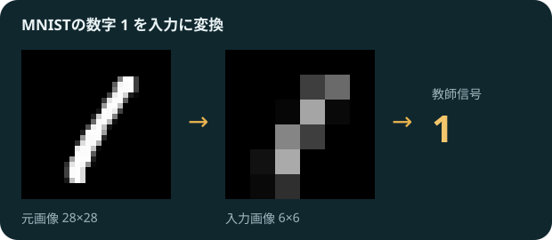
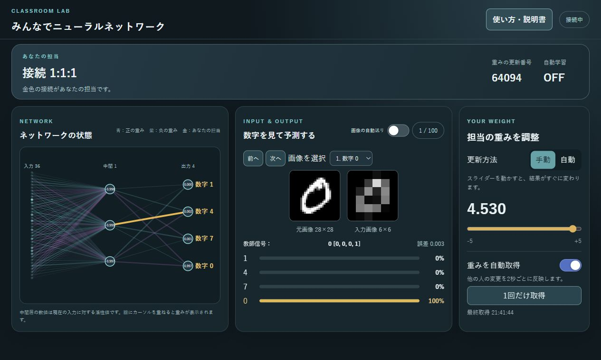

# 学生向けガイド：みんなでニューラルネットワーク

この授業では、全員で一つのニューラルネットワークを使います。あなたには、線に付いた数値「重み」が一つ割り当てられます。その値を変えると、AIの数字の予測がどう変わるかを試せます。

## どんな数字を見ているの？

MNISTは手書き数字の画像を集めたデータです。このアプリでは **1・4・7・0** の4種類を使います。元の28×28画素の画像を6×6画素に小さくし、36個の明るさをネットワークの入力にします。

図は、この授業で使う画像の一例です。学生画面では100枚の画像から選べます。

## 画面の見方と操作

1. **ネットワークの状態**：左の36個が入力、右の4個が数字の予測です。金色の線があなたの担当です。青い線は正、紫の線は負の重みを表します。
2. **数字を見て予測する**：「前へ」「次へ」や画像一覧から画像を選べます。「画像の自動送り」をONにすると2秒ごとに次へ進み、100枚目の次は1枚目に戻ります。棒グラフは各数字だと思う割合、教師信号は正解です。自動送りをOFFにすると選んだ画像のままになります。
3. **担当の重みを調整**：「手動」にしてスライダーを動かすと、予測がその場で再計算され、値がサーバに共有されます。「自動」にすると、教員が自動学習をONにしたときサーバが更新します。
4. **重みを自動取得**：ONなら、ほかの人やサーバによる変更を2秒ごとに反映します。OFFでも「1回だけ取得」で最新の値を確認できます。

## まずはこう試してみよう

1. 画像を一つ選び、予測と正解を見る。
2. 担当の重みを「手動」にし、スライダーを少し動かして予測と誤差の変化を見る。
3. 別の画像に切り替え、同じ重みの変更がどう働くか比べる。

教員が表示画像を固定した場合、解除されるまで学生側で画像を変更できません。教員が全員の重みを自動モードに固定した場合も、解除されるまでモードを変更できません。
